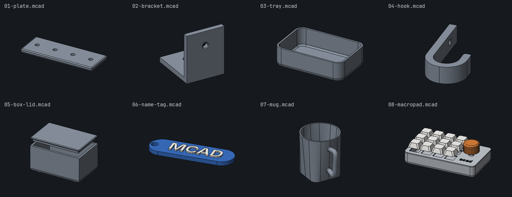

# mcad

Parametric CAD in an OpenSCAD-style language on an exact B-rep kernel. CLI for AI agents,
desktop/browser UI for humans.

> **Alpha.** Expect breaking changes. Tested on Linux. The repository URL will probably change.


## Motivation

I like OpenSCAD, but some features are missing: fillets on arbitrary edges, exact geometry,
named references instead of repeated coordinates, STEP export. mcad keeps the OpenSCAD syntax
and uses a B-rep kernel ([SMLib](https://github.com/tangency-labs/smlib)). That gives:

- fillets, chamfers, shells, lofts, sweeps on exact surfaces
- exact measurements (radius, wall thickness, volume) and STEP with real cylinders and arcs
- `$fn` only affects display

## AI first

The CLI is built for coding agents like Claude Code: write, check, look at, measure and export
a model without a UI.

- `--json` on every command, versioned schema, stable exit codes
- `mcad usage`: manual for agents, compiled into the binary
- `mcad render`: PNGs with grids, anchors, sections, X-ray, highlighted code lines
- `mcad measure`: numbers instead of pictures
- daemon keeps the kernel cache between calls; `mcad ui status` shows what the human has open

```sh
mcad outline part.mcad                 # modules, parameters, grids, anchors, parts
mcad check part.mcad                   # until 0 errors
mcad render part.mcad -o v.png --views all --show grids,anchors
mcad measure part.mcad --section z=8 --wall "[1.2,30,8]"
mcad export part.mcad -o part.3mf
```

Claude Code skill: [`.claude/skills/cad-cli/`](.claude/skills/cad-cli/SKILL.md). CLI text
output is English by default, German with `--lang de` (or `MCAD_LANG=de`, German locale);
`--help`, `mcad usage` and JSON keys are always English.

## Tutorial

[`examples/`](examples/): short models, each builds on the previous one.

| File | Shows |
| --- | --- |
| [`01-plate`](examples/01-plate.mcad) | OpenSCAD basics, parameters, `$fillet` |
| [`02-bracket`](examples/02-bracket.mcad) | grids, `box(a, b)`, `cylinder(a, b)`, `difference(chamfer = …)` |
| [`03-tray`](examples/03-tray.mcad) | fillet zones, `shell` |
| [`04-hook`](examples/04-hook.mcad) | `sketch`: lines, arcs, `corner` |
| [`05-box-lid`](examples/05-box-lid.mcad) | modules, anchors, parts, clearance |
| [`06-name-tag`](examples/06-name-tag.mcad) | `text`, `slot`, colours, multi-colour 3MF |
| [`07-mug`](examples/07-mug.mcad) | `loft`, `sweep`, `union(fillet = …)` |
| [`08-macropad`](examples/08-macropad.mcad) | all of it, plus collision asserts |



## Features

Shown on [`08-macropad.mcad`](examples/08-macropad.mcad).

**Grids and anchors.** Named planes instead of loose numbers; lists give indexed planes.
Anchors are points other parts attach to; named instances are parts.

```openscad
grid g {
    x: left = 0, key = [for (i = [0 : cols - 1]) kx(i)], enc = w - margin - enc_w / 2, right = w;
    y: front = 0, row = [for (j = [0 : rows - 1]) ky(j)], back = d;
    z: bottom = 0, top = plate_t;
}
anchor encoder = g[enc, row[1], top], dir = [0, 0, 1];
…
translate(plate.encoder + [0, 0, 7]) knob: knob();
```


**Fillet zones.** A fillet rounds the edges of its first child that lie in the zones.
`shell` opens the faces in its zones.

```openscad
shell(wall) {
    fillet(r) {
        box(g[left, front, bottom], g[right, back, top]);
        zone(g[left, front, *], d = 1);          // cylinder around a grid line
        …
    }
    zone(g.top, d = 1);                          // slab around a grid plane: open top
}
```


**Exact measurement** on the B-rep, also in sections:

```console
$ mcad measure 08-macropad.mcad --section z=8 --wall "[1.2, 30, 8]"
  arc R 6 · ⌀ 12 at [6, 59.15, 8] (center@[6,59.15,8])
  …
Wall thickness point [1.2, 30, 8]: 2.4 mm
```


**Collision asserts.** A keep-out volume (switches, PCB) is shown but not exported. A
violation is a warning; `mcad export` stops with exit 4.

```openscad
assert_keepout(clearance = 0.5) translate([0, 0, -11]) { switches(); pcb(); }
```

```console
$ mcad check 08-macropad.mcad -D h=12
08-macropad.mcad:104:18: warning (kernel): assert_keepout: case enters the keep-out volume (intersection volume 8497.131 mm³) [line 34: shell (instance case: case)]
```


**Colours and text.** `color("teal")` from a 16-colour palette, filament slots, 3MF with one
part per colour for Bambu Studio/OrcaSlicer. `text()` with bundled fonts.


**Also:** sketch editor, section view and measuring in the UI; `loft`, `sweep`, variable
fillet radius; SVG and STL import; STL/3MF/STEP export per part; `.scad` files open unchanged
(36 models compared against OpenSCAD 2021.01). UI in English and German.

## Build

Needs Rust, a C++17 compiler, CMake ≥ 3.20, Node 22 + pnpm 10 (UI), emsdk (browser only).

```sh
smlib/fetch.sh          # SMLib sources -> third_party/smlib
make cli                # target/release/mcad, headless
make app                # with desktop UI (Tauri 2, WebKitGTK)
make web                # browser app -> web/dist
make test
```

`make` lists all targets. Details (German): [`docs/development.md`](docs/development.md).

## Installation

| Platform | How |
| --- | --- |
| Arch Linux | `make arch-pkg`, then `sudo pacman -U target/arch/mcad-*.pkg.tar.zst` |
| Other | TODO; for now `make app && make install` |

## Documentation

- [Quick reference](manuell/20-quickref.md) (`mcad usage quickref`): all functions on one page
- `mcad usage` / [`manuell/`](manuell/): language and CLI reference
- [`docs/reports/`](docs/reports/README.md): test reports per milestone
- [`docs/technical-plan.md`](docs/technical-plan.md): technical plan (German)

## License

[MIT](LICENSE). SMLib: Apache-2.0 (fetched at build time). Bundled fonts: SIL OFL 1.1. Details:
[`packaging/linux/NOTICE`](packaging/linux/NOTICE).
