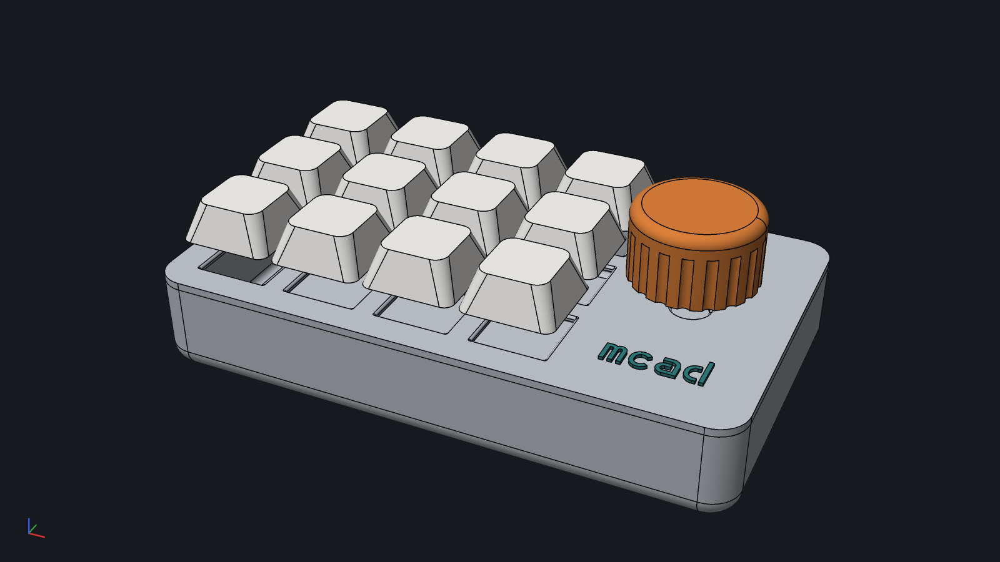
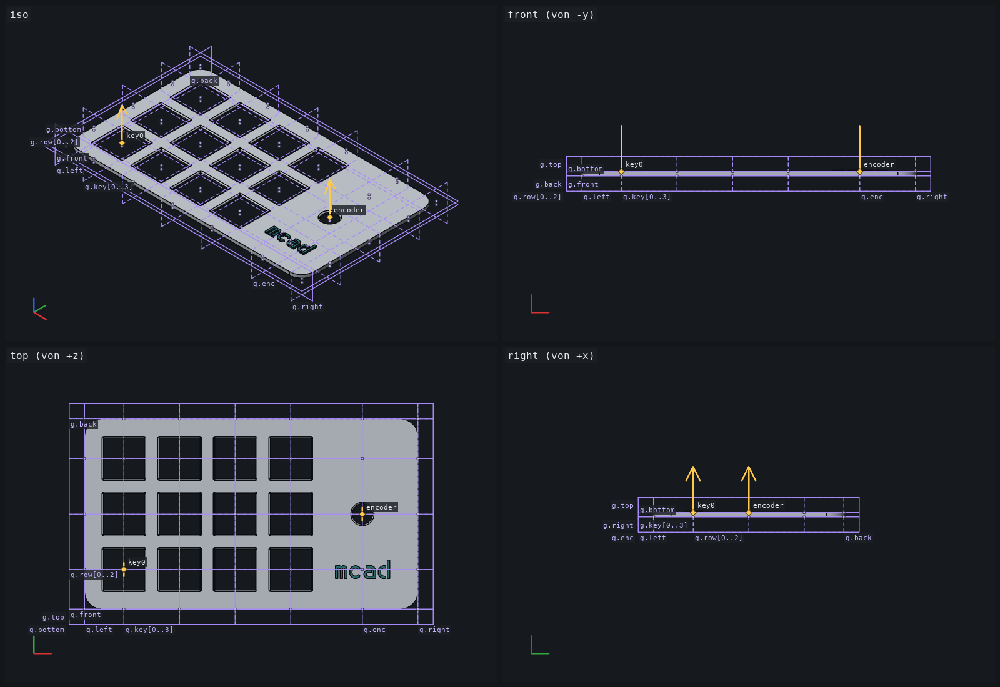
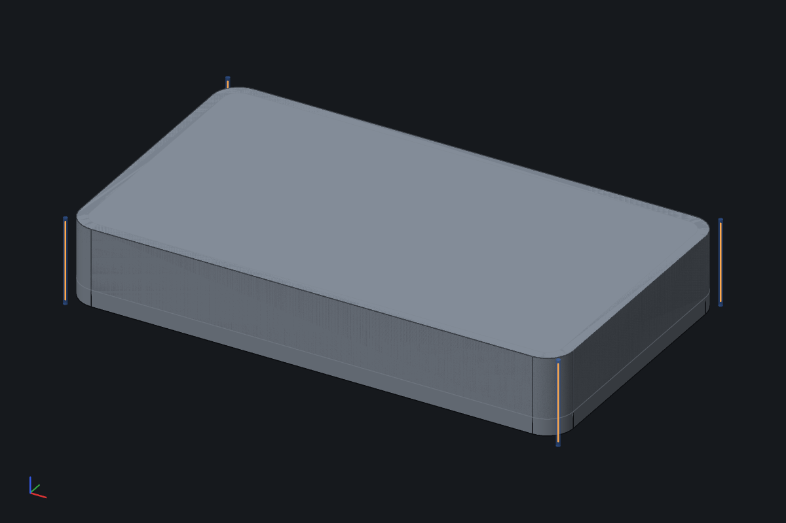
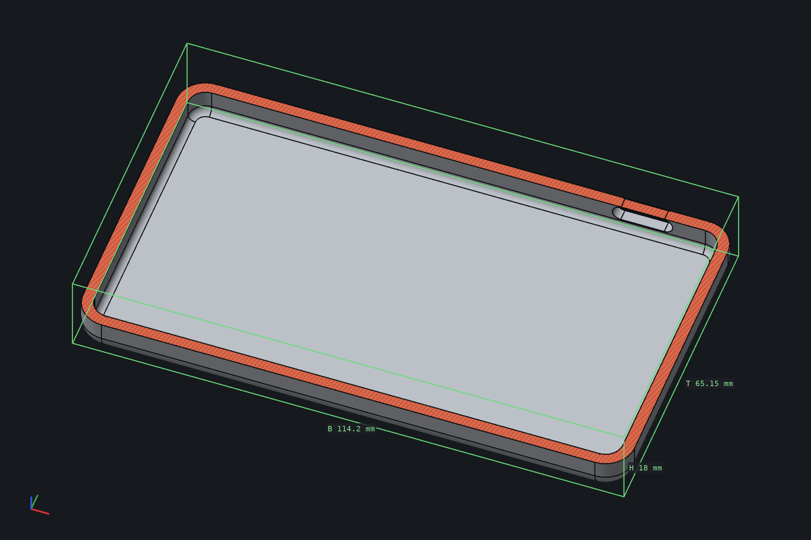
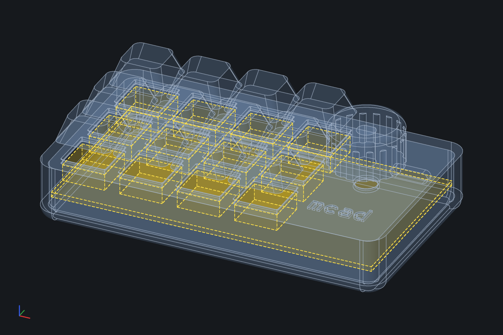
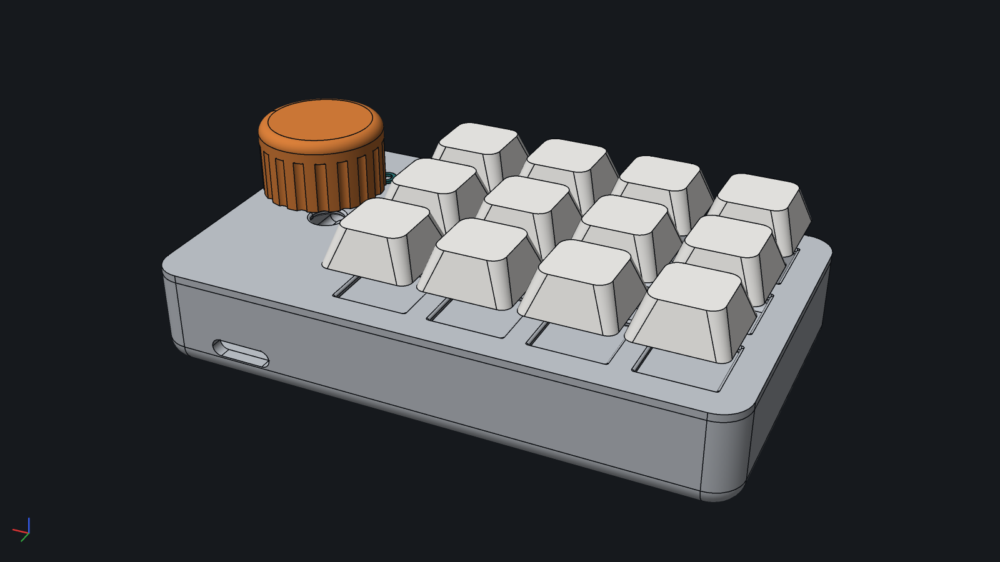

# mcad

Parametric CAD in an OpenSCAD-style language, on an exact B-rep kernel, with a CLI built for
AI agents and a desktop/browser UI for humans.

> **Status: alpha.** Expect breaking changes in the language, the CLI and the file formats.
> Hobby project, tested on Linux. The repository URL will probably change.



## Motivation

I like OpenSCAD: models are plain text, parametric, diffable, and easy to generate. A few
things are missing for the parts I print:

- **Fillets and chamfers** on arbitrary edges, not only on the shapes you can build with
  `hull` and `minkowski`.
- **Exact geometry.** OpenSCAD works on meshes; a cylinder is a polygon with `$fn` sides.
- **Named references** instead of repeating coordinates: planes, points, attachments.
- **Checking a model without looking at it**: distances, wall thickness, collisions.
- **STEP export** for other CAD tools.

mcad keeps the OpenSCAD syntax and adds what is missing. Geometry is a boundary
representation (B-rep, kernel [SMLib](https://github.com/tangency-labs/smlib)), so:

| B-rep gives | Example |
| --- | --- |
| fillets/chamfers on selected edges | `fillet(2) { body; zone(g.top, d = 1); }` |
| exact measurements | radius `R 6`, wall thickness `2.4 mm`, volume `29485.7965 mm³` |
| exact STEP (AP242/AP214) | cylinders stay cylinders, arcs stay arcs |
| shells, offsets, lofts, sweeps | `shell(2.4) { … }`, `loft() { … }` |
| `$fn` only affects display | no faceting decisions in the model |

## AI first

The CLI `mcad` is designed for coding agents such as Claude Code: an agent can write, check,
look at, measure and export a model without a UI.

- Every command has `--json` with a fixed, versioned schema and stable exit codes.
- `mcad usage` prints a manual for agents/LLMs (compiled into the binary, `manuell/`).
- `mcad render` writes PNGs an agent can look at: contact sheets, grids and anchors overlaid,
  sections, X-ray, highlighted lines of code.
- `mcad measure` answers questions with numbers instead of pictures.
- Diagnostics carry `file:line:column`; kernel errors name the statement and the cause.
- A daemon keeps the kernel cache between calls, `mcad watch` re-evaluates on every save.
- With the desktop UI open, `mcad ui status` tells the agent what the human is looking at.

Typical agent loop:

```sh
mcad outline part.mcad                                    # modules, parameters, grids, anchors, parts
mcad check part.mcad                                      # until 0 errors
mcad render part.mcad -o v.png --views all --show grids,anchors
mcad inspect part.mcad --line 34                          # what this line produces
mcad measure part.mcad --section z=8 --wall "[1.2,30,8]"  # verify numbers
mcad export part.mcad -o part.3mf
```

A Claude Code skill for this workflow is in [`.claude/skills/cad-cli/`](.claude/skills/cad-cli/SKILL.md).

Note: text output of the CLI (diagnostics, results) is German for now; `--help`, `mcad usage`
and all JSON keys are English.

## Example: a macro pad

[`examples/macropad/macropad.mcad`](examples/macropad/macropad.mcad): 4 × 3 MX keys, a rotary
encoder, USB-C. 15 parts, four filament colours, about 110 lines. All images below are
`mcad render … --theme dark`.

### Grids and anchors

Named planes replace loose coordinates. Lists make indexed planes; every key position is a
grid point. Anchors are named points that other parts attach to.

```openscad
module plate() {
    grid g {
        x: left = 0, key = [for (i = [0 : cols - 1]) kx(i)], enc = w - margin - enc_w / 2, right = w;
        y: front = 0, row = [for (j = [0 : rows - 1]) ky(j)], back = d;
        z: bottom = 0, top = plate_t;
    }
    difference(fillet = 0.5) {                    // rounds the edges the cut creates
        linear_extrude(plate_t) fillet2d(r) square([w, d]);
        for (i = [0 : cols - 1], j = [0 : rows - 1])
            box(g[key[i], row[j], bottom] - [7, 7, 1], g[key[i], row[j], top] + [7, 7, 1]);
        translate(g[enc, row[1], bottom] - [0, 0, 1]) cylinder(h = plate_t + 2, d = 7);
    }
    anchor encoder = g[enc, row[1], top], dir = [0, 0, 1];
}

case: case();                                      // named instances are parts
translate(case.rim) plate: plate();
translate(plate.encoder + [0, 0, 7]) knob: knob();
```

`mcad render macropad.mcad -o grids.png --module plate --views all --show grids,anchors,labels`:



### Fillet zones

A fillet selects the edges of its first child that lie inside the zones that follow: a
cylinder around a grid line, a slab around a grid plane, or any volume. `shell` uses the same
zones to choose the faces it opens.

```openscad
shell(wall) {
    fillet(wall + 1.5) {                  // bottom edge; radius > wall, else shell fails
        fillet(r) {                       // vertical corners
            box(g[left, front, bottom], g[right, back, top]);
            zone(g[left, front, *], d = 1);
            zone(g[right, front, *], d = 1);
            zone(g[left, back, *], d = 1);
            zone(g[right, back, *], d = 1);
        }
        zone(g.bottom, d = 1);
    }
    zone(g.top, d = 1);                   // open top
}
```

`mcad inspect macropad.mcad --line 34` reports `ausgewählte Kanten: 4` (selected edges);
`mcad render … --line 34` shows the zones in blue and the selected edges in orange:



### Exact measurement

Measurements run on the B-rep, not on the mesh. In a section, contours are lines and arcs
with their radii:

```console
$ mcad measure macropad.mcad --section z=8 --wall "[1.2, 30, 8]"
Schnitt z = 8 (entfernt z > 8): 1 Bereich(e), Fläche 818.0623 mm² (exakt: Konturen aus Geraden und Kreisen der B-Rep)
  Bogen R 6 · ⌀ 12 bei [6, 59.15, 8] (center@[6,59.15,8])
  Bogen R 3.6 · ⌀ 7.2 bei [6, 59.15, 8] (center@[6,59.15,8])
  …
Wandstärke Punkt [1.2, 30, 8]: 2.4 mm
  senkrecht zur Kontur von [0, 30, 8] bis [2.4, 30, 8]
```



Also: distance with foot points, angle, length, area, volume, clearance between parts
(`mcad usage measure`). The desktop UI has the same measuring tool.

### Collision asserts

Asserts are checked after evaluation. A keep-out volume is shown but never exported; here it
stands for the switch bodies and the PCB:

```openscad
if (keepout) assert_keepout(clearance = 0.5) translate([0, 0, -11]) {
    for (i = [0 : cols - 1], j = [0 : rows - 1])
        translate([kx(i) - 7, ky(j) - 7, 5]) cube([14, 14, 5.4]);
    translate([margin, margin, 0]) cube([w - 2 * margin, d - 2 * margin, 1.6]);
}
```



Make the case too low and the check fails; `mcad export` refuses to write (exit 4):

```console
$ mcad check macropad.mcad -D h=12
macropad.mcad:102:18: Warnung (Kernel): assert_keepout: case ragt ins Sperrvolumen (Schnittvolumen 8497.131 mm³) [Zeile 32: shell (Instanz case: case)]
Asserts: 1 von 1 geprüft, 1 verletzt (1 Verletzung(en); mcad export bricht dann ab, außer mit --ignore-asserts)
```

Also `assert_disjoint`, `assert_intersect`, `assert_touches` (`mcad usage asserts`).

### Colours, text, multi-material 3MF

`color()` assigns print colours from a 16-colour palette, optionally with a filament slot.
`mcad export x.3mf` writes one object per part and one part per colour, with slots for Bambu
Studio and OrcaSlicer. `text()` uses bundled fonts; the default is a stencil font whose
glyphs have no islands.

```openscad
color("teal") translate(g[enc, row[0], top]) linear_extrude(0.6)
    text("mcad", size = 6, halign = "center", valign = "center");
```

```console
$ mcad measure macropad.mcad --colors
Farben (Filament, Farbe, Volumen, Masse PLA 1,24 g/cm³):
  F1  Standard       #c3c8cf  36938.4663 mm³  45.8 g  (ohne color())
  F2  teal           #217274  24.1309 mm³  0.03 g  Z.65
  F3  orange         #dc813b  5810.2486 mm³  7.2 g  Z.73
  F4  white          #f4f3f0  21417.294 mm³  26.56 g  Z.89
```



## More features

| Area | Features |
| --- | --- |
| Language | OpenSCAD syntax (modules, functions, `for`/`if`/`let`, list comprehensions, `include`/`use`), `.scad` files open unchanged; modules as namespaces; `box(a, b)`, `cylinder(a, b, r)`, `slot`, `torus` |
| Sketches | `sketch { line; arc; bezier; spline; corner(r); hole { … } }`, exact `offset`, `fillet2d`, `chamfer2d`, `stroke`; sketch editor in the UI |
| 3D | `loft`, `sweep`, `surface` + `thicken`, `shell`, variable fillet radius `fillet(r = function (p) …)`, exact special cases of `hull`/`minkowski` |
| Import | SVG as exact 2D profile, STL as B-rep (≤ 500 faces) or mesh |
| Export | STL, multi-colour 3MF, STEP; per part (`--all-parts`) |
| UI | code and 3D view coupled (cursor highlights geometry, handles write literals back into the code), section view, measuring, colours and filaments, parameters, file watcher, Git gutter; English and German |
| CLI | `outline`, `check`, `eval`, `inspect`, `render`, `measure`, `set`, `watch`, `export`, `ui`, `daemon`, `usage` |

OpenSCAD compatibility: 36 reference models are compared against OpenSCAD 2021.01
(`tests/openscad-compat/`). Not supported: `projection`; `polyhedron` only for small planar
bodies; `hull`/`minkowski` outside the exact special cases warn and keep the children.

## Build

Requirements: Rust (with target `wasm32-unknown-unknown` for the browser build), a C++17
compiler, CMake ≥ 3.20, Node 22 and pnpm 10 (UI), emsdk (browser build only).

```sh
smlib/fetch.sh                  # SMLib sources + patches -> third_party/smlib
make cli                        # target/release/mcad without the desktop UI
make app                        # with the desktop UI (Tauri 2, needs WebKitGTK)
make web                        # browser app -> web/dist (needs emcc: make emsdk)
make test                       # cargo test + Vitest
make install PREFIX=~/.local    # binary, desktop file, icons, docs
```

`make` lists all targets. Arch Linux package: `make arch-pkg`. Details on building, tests and
the code layout (German): [`docs/entwicklung.md`](docs/entwicklung.md).

```sh
mcad                            # desktop UI
mcad examples/macropad/macropad.mcad
mcad usage                      # manual for agents
```

## Documentation

| Where | What |
| --- | --- |
| `mcad usage`, [`manuell/`](manuell/) | language and CLI reference (English) |
| [`docs/reports/`](docs/reports/README.md) | test reports per milestone with screenshots and measurements (English) |
| [`examples/`](examples/) | example models (also test cases; comments partly German) |
| [`docs/technischer-plan.md`](docs/technischer-plan.md) | technical plan and decisions (German) |

## Architecture

```
Browser:  React/TS (CodeMirror 6, three.js) ── Web Worker ── cad-wasm ── smlib.wasm
Desktop:  Tauri 2 (same React app) ── engine process (cad-session, SMLib native)
CLI:      cad-cli ── daemon (cad-ipc) ── cad-session ── cad-engine ── kernel-smlib (SMLib, FFI)
Language: cad-syntax (parser) → cad-eval (values with origin, grids, anchors) → cad-ir (tree)
```

The same Rust crates run in the browser (Wasm) and natively. The engine caches results by
content and evaluates incrementally.

## License

[MIT](LICENSE). Third-party components keep their licenses: SMLib/SM_API (Apache-2.0,
fetched at build time), bundled fonts JetBrains Mono, Inter, Allerta Stencil (SIL OFL 1.1,
`crates/cad-font/fonts/`), Rust crates and npm packages (mostly MIT/Apache-2.0). See
[`packaging/linux/NOTICE`](packaging/linux/NOTICE).
